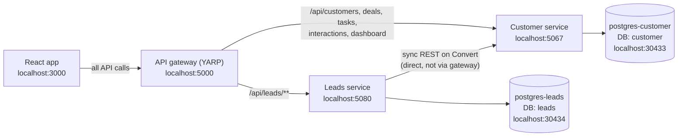
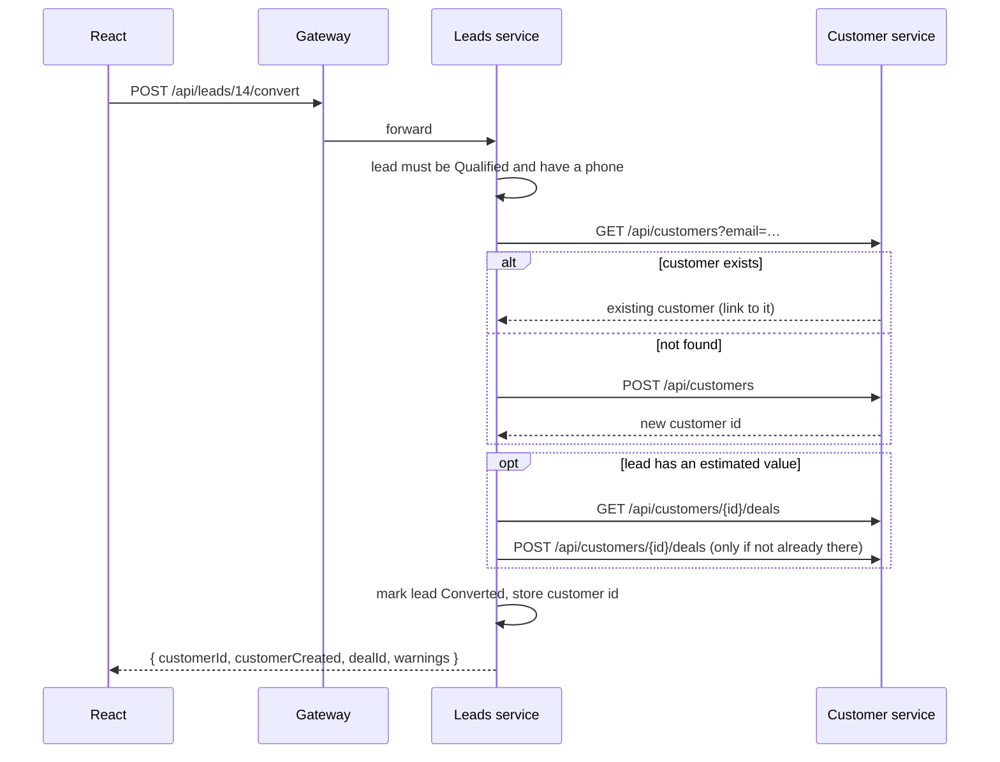

# SeeRM – Architecture & Running Locally

SeeRM is a small CRM built as microservices. Each service owns its own database, and the React app reaches every service through a single API gateway.

| Doc | Covers |
|---|---|
| **architecture.md** (this) | Components, data ownership, request flows, failure behaviour, how to run everything |
| [low-level-design.md](low-level-design.md) | Customer service: data model, API, validation |
| [leads-low-level-design.md](leads-low-level-design.md) | Leads service: data model, API, convert flow |
| [microservices-leads-plan.md](microservices-leads-plan.md) | The plan and decisions behind the split, phase by phase |

## 1. Components



| Component | Code | Port | Owns |
|---|---|---|---|
| React app | `frontend/` | 3000 | UI only. Calls the gateway at `REACT_APP_API_BASE_URL` (`frontend/.env.development`) |
| API gateway | `backend/gateway/SeeRM.Gateway` | 5000 | Routing, CORS, combined Swagger UI, aggregated health |
| Customer service | `backend/seerm-dotnet` | 5067 | Customers, deals, tasks, interactions, dashboard KPIs |
| Leads service | `backend/services/leads/SeeRM.Leads.Api` | 5080 | Leads, lead KPIs, lead → customer conversion |
| Customer DB | `k8s/postgres-customer`, `sqlscripts/customer/` | 30433 | `customer` database, login `customer_svc` |
| Leads DB | `k8s/postgres-leads`, `sqlscripts/leads/` | 30434 | `leads` database, login `leads_svc` |

All services are .NET 10 with EF Core 10 (Npgsql), Swagger, RFC 7807 `ProblemDetails` errors and a `/health` endpoint. The databases are PostgreSQL 17 StatefulSets on the local Docker Desktop Kubernetes cluster, each with its own persistent volume.

## 2. Data ownership rules

- **A service only talks to its own database.** No cross-database queries, no shared tables, no shared credentials.
- **Services talk to each other only over HTTP.** Today the only such call is Leads → Customer during conversion.
- **Cross-service references are plain IDs, not foreign keys.** `leads.converted_customer_id` holds a Customer service ID. Deleting a customer doesn't touch the lead, and vice versa.
- **Browsers only reach the gateway.** The services don't enable CORS; duplicate CORS headers would be rejected by browsers.

## 3. Request flows

### Reading the Leads screen

`React → GET localhost:5000/api/leads?status=Qualified → gateway → Leads service → leads DB`

### Converting a lead



Every step is safe to retry, so a failure part-way never creates duplicates. Details in [leads-low-level-design.md](leads-low-level-design.md#5-convert-flow).

## 4. When something is down

| What's down | Effect |
|---|---|
| Leads service | Gateway returns an immediate `503` for `/api/leads/**`: "The leads service is unavailable right now…". Customer screens keep working. |
| Customer service | Gateway returns `503` for customer routes. **Convert** returns `503` in about 2–3 s and leaves the lead unchanged; retry once it's back. Lead CRUD keeps working. Leads `/health` reports `Degraded`. |
| A database | That service's `/health` reports `Unhealthy`; its requests fail with `500`. |
| Gateway | The UI can't reach anything. The services still work directly (`:5067/swagger`, `:5080/swagger`). |

Recovery is automatic: the gateway health-checks each service every 5 s and resumes routing as soon as it's back.

Health endpoints:
- `GET localhost:5000/health`: gateway plus each service, as JSON
- `GET localhost:5067/health`, `GET localhost:5080/health`: each service on its own

## 5. Running locally

### Prerequisites

- Docker Desktop with Kubernetes enabled (context `docker-desktop`)
- .NET SDK 10, Node.js
- About 2 GB of free RAM for everything (all four processes plus the database pods)

### First-time setup

Skip any step that's already done (the secrets and database pods persist).

```bash
# 1. Database credentials (random passwords, stored only in the cluster)
kubectl create secret generic postgres-customer-credentials \
  --from-literal=POSTGRES_USER=customer_svc --from-literal=POSTGRES_PASSWORD="$(openssl rand -hex 12)" --from-literal=POSTGRES_DB=customer
kubectl create secret generic postgres-leads-credentials \
  --from-literal=POSTGRES_USER=leads_svc --from-literal=POSTGRES_PASSWORD="$(openssl rand -hex 12)" --from-literal=POSTGRES_DB=leads

# 2. Database pods
kubectl apply -f k8s/postgres-customer/postgres-customer.yaml
kubectl apply -f k8s/postgres-leads/postgres-leads.yaml
kubectl rollout status statefulset/postgres-customer && kubectl rollout status statefulset/postgres-leads

# 3. Schema + mock data (destructive: drops and recreates the tables)
for f in sqlscripts/customer/001_create_tables.sql sqlscripts/customer/002_insert_mock_data.sql; do
  kubectl exec -i postgres-customer-0 -- sh -c 'psql -v ON_ERROR_STOP=1 -U "$POSTGRES_USER" -d "$POSTGRES_DB"' < "$f"; done
for f in sqlscripts/leads/001_create_tables.sql sqlscripts/leads/002_insert_mock_data.sql; do
  kubectl exec -i postgres-leads-0 -- sh -c 'psql -v ON_ERROR_STOP=1 -U "$POSTGRES_USER" -d "$POSTGRES_DB"' < "$f"; done

# 4. Give each service its DB password via .NET user-secrets (never stored in the repo)
dotnet user-secrets set "Database:Password" "$(kubectl get secret postgres-customer-credentials -o jsonpath='{.data.POSTGRES_PASSWORD}' | base64 -d)" \
  --project backend/seerm-dotnet
dotnet user-secrets set "Database:Password" "$(kubectl get secret postgres-leads-credentials -o jsonpath='{.data.POSTGRES_PASSWORD}' | base64 -d)" \
  --project backend/services/leads/SeeRM.Leads.Api

# 5. Frontend packages
(cd frontend && npm install)
```

### Every time

Start Docker Desktop, then run each of these in its own terminal. Order doesn't matter: until a service is up, the gateway answers its routes with `503`, and it starts routing within ~5 s of the service starting.

| Terminal | Command | URL |
|---|---|---|
| Customer service | `dotnet run --launch-profile http --project backend/seerm-dotnet` | http://localhost:5067/swagger |
| Leads service | `dotnet run --launch-profile http --project backend/services/leads/SeeRM.Leads.Api` | http://localhost:5080/swagger |
| Gateway | `dotnet run --launch-profile http --project backend/gateway/SeeRM.Gateway` | http://localhost:5000/swagger |
| React | `cd frontend && npm start` | http://localhost:3000 |

Check `http://localhost:5000/health` shows every service as `Healthy`.

### Configuration

| Setting | Where | Value (dev) |
|---|---|---|
| Customer DB connection | `backend/seerm-dotnet/appsettings.Development.json` → `ConnectionStrings:SeeRm` | `Host=localhost;Port=30433;Database=customer;Username=customer_svc` |
| Leads DB connection | `…/SeeRM.Leads.Api/appsettings.Development.json` → `ConnectionStrings:Leads` | `Host=localhost;Port=30434;Database=leads;Username=leads_svc` |
| DB passwords | user-secrets `Database:Password` (or env var `Database__Password`) | from the Kubernetes secrets |
| Leads → Customer URL | `…/SeeRM.Leads.Api/appsettings.Development.json` → `Services:Customer:BaseUrl` | `http://localhost:5067` |
| Gateway routes & service addresses | `backend/gateway/SeeRM.Gateway/appsettings.json` → `ReverseProxy` | see file |
| Allowed browser origins | `backend/gateway/SeeRM.Gateway/appsettings.Development.json` → `Cors:AllowedOrigins` | `http://localhost:3000` |
| API base URL for React | `frontend/.env.development` → `REACT_APP_API_BASE_URL` | `http://localhost:5000` (restart `npm start` after changing) |

### Tests

- Frontend: `cd frontend && CI=true npx react-scripts test --watchAll=false`
- APIs: sample requests in each project's `.http` file, or Swagger.

## 6. Databases

| Pod | Port | Database / login | Secret | Status |
|---|---|---|---|---|
| `postgres-customer-0` | 30433 | `customer` / `customer_svc` | `postgres-customer-credentials` | **In use** (Customer service) |
| `postgres-leads-0` | 30434 | `leads` / `leads_svc` | `postgres-leads-credentials` | **In use** (Leads service) |
| `postgres-0` | 30432 | `seerm` / `postgres` | `postgres-credentials` | **Retired, kept.** The original monolith DB; its data was copied to `customer`. Nothing uses it. Delete only on explicit approval: `kubectl delete -f k8s/postgres/postgres.yaml` then `kubectl delete pvc postgres-data` (the second command permanently deletes the data). |

Data survives pod and StatefulSet deletion (persistent volumes). Deleting a PVC, or "Reset Kubernetes Cluster" in Docker Desktop, deletes that data.

Get a password: `kubectl get secret postgres-leads-credentials -o jsonpath="{.data.POSTGRES_PASSWORD}" | base64 -d`

**Connecting with DBeaver / CloudBeaver:** use host `localhost` from the DBeaver desktop app, but **`host.docker.internal`** from CloudBeaver (it runs in a container, where `localhost` is the container itself). Remember to set the **database name** (`customer` or `leads`); the default `postgres` database is empty.

## 7. Troubleshooting

| Symptom | Cause / fix |
|---|---|
| UI shows old behaviour, or calls the wrong port | A stale `npm start` from an earlier session may still hold port 3000 (stopping a parent shell doesn't always stop its Node children). Find it with `Get-NetTCPConnection -LocalPort 3000 -State Listen` and stop it, then `npm start` again. |
| `Something is already running on port 3000/5000/5067/5080` | Same as above: an earlier run is still alive. |
| "Cannot reach the API at http://localhost:5000" in the UI | The gateway isn't running. |
| "The leads/customer service is unavailable" | That service isn't running (or is still starting). Check `localhost:5000/health`. |
| `password authentication failed` | The user-secret doesn't match the Kubernetes secret. Re-run step 4 of first-time setup. |
| `Connection refused` on 30433/30434 | Docker Desktop / Kubernetes isn't running, or the pod isn't ready: `kubectl get pods`. |
| Processes killed unexpectedly | The machine ran low on memory. Close other apps; everything needs about 2 GB. |
| Build error "file is locked by SeeRM.…" | That service is still running. Stop it before rebuilding. |
