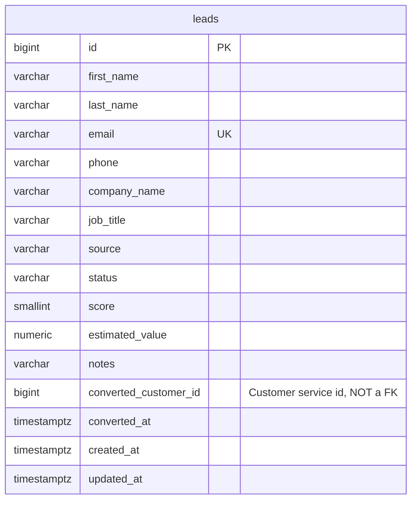
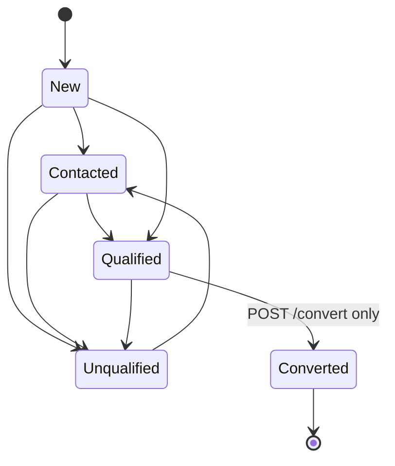

# SeeRM Leads Service – Low-Level Design

> Part of the SeeRM microservices. For the overall system see [architecture.md](architecture.md); for the Customer service see [low-level-design.md](low-level-design.md).

## 1. Scope

The Leads service manages prospects before they become customers, and converts qualified leads into customers in the Customer service.

| Screen | Route | What it needs |
|---|---|---|
| Leads (`features/leads/leads-page.jsx`) | `/leads` | KPI cards; leads list with status tabs, search, source filter, paging; Convert, Edit and Delete actions |
| New / Edit Lead (`features/leads/lead-form.jsx`) | `/leads/new`, `/leads/:id/edit` | Create and update a lead |

- **Code:** `backend/services/leads/SeeRM.Leads.Api` (port 5080)
- **Database:** `leads` on the `postgres-leads` pod (port 30434), owned only by this service
- **Reached by the browser** through the gateway at `localhost:5000/api/leads/**`

## 2. Architecture

```
Gateway ──▶ LeadsController ──▶ LeadService ───────────────▶ LeadsDbContext ──▶ postgres-leads (leads)
                            └─▶ LeadConversionService ──┬─▶ LeadsDbContext
                                                        └─▶ CustomerServiceClient ──HTTP──▶ Customer service
```

| Folder | Contents |
|---|---|
| `Controllers/` | `LeadsController`: routes, status codes, Swagger metadata |
| `Services/` | `LeadService` (CRUD, list, KPIs), `LeadConversionService` (convert flow) |
| `Integration/` | `CustomerServiceClient`: typed `HttpClient` for the Customer service, with error mapping |
| `Data/` | `LeadsDbContext`: EF Core mapping onto the existing schema (database-first, no migrations) |
| `Domain/` | `Lead` entity and allowed status / source values |
| `Contracts/` | Request/response DTOs with validation |
| `Infrastructure/` | `ProblemDetails` error handling, health checks |

## 3. Data model



| Column | Type | Rules |
|---|---|---|
| id | BIGINT identity | PK |
| first_name, last_name | VARCHAR(80) | required |
| email | VARCHAR(254) | required, email format, **unique (case-insensitive)** |
| phone | VARCHAR(15) | optional, `^[0-9+\-\s()]{7,15}$`; **required to convert** |
| company_name | VARCHAR(150) | optional |
| job_title | VARCHAR(120) | optional |
| source | VARCHAR(20) | `website` \| `referral` \| `event` \| `cold_call` \| `social` \| `other` |
| status | VARCHAR(20) | `New` \| `Contacted` \| `Qualified` \| `Unqualified` \| `Converted` |
| score | SMALLINT | 0–100 |
| estimated_value | NUMERIC(12,2) | optional, ≥ 0 |
| notes | VARCHAR(2000) | optional |
| converted_customer_id | BIGINT | ID in the Customer service. **Not a foreign key:** that table is in another service's database |
| converted_at | TIMESTAMPTZ | set with `converted_customer_id` |
| created_at, updated_at | TIMESTAMPTZ | `updated_at` maintained by trigger |

Constraint `ck_leads_converted`: status is `Converted` **if and only if** `converted_customer_id` and `converted_at` are set.

Indexes: unique `lower(email)`, `status`, `source`, `created_at DESC`.

### Status lifecycle (typical flow)



The diagram shows the usual path; the API doesn't enforce an order, so `PUT` can move a lead between any of New / Contacted / Qualified / Unqualified. `Converted` can only be reached through the convert endpoint, and a converted lead is read-only.

## 4. REST API

Base path `/api/leads` (via the gateway: `http://localhost:5000/api/leads`). JSON is camelCase; errors are `ProblemDetails`.

| Method | Path | Purpose | Success | Errors |
|---|---|---|---|---|
| GET | `/api/leads?search=&status=&source=&page=1&pageSize=20` | List, newest first. `search` matches full name, email or company (case-insensitive) | 200 | 400 unknown status/source |
| GET | `/api/leads/summary` | KPI values | 200 | |
| GET | `/api/leads/{id}` | One lead | 200 | 404 |
| POST | `/api/leads` | Create | 201 + `Location` | 400 validation, 409 duplicate email |
| PUT | `/api/leads/{id}` | Full update | 200 | 400, 404, 409 duplicate email or lead already converted |
| DELETE | `/api/leads/{id}` | Delete (doesn't affect any customer it was converted to) | 204 | 404 |
| POST | `/api/leads/{id}/convert` | Convert to a customer (see §5) | 200 | 400, 404, 409 already converted, 503 Customer service unavailable |
| GET | `/health` | `Healthy` / `Degraded` (Customer service down) / `Unhealthy` (DB down) | 200 / 503 | |

**Create / update body**

```json
{
  "firstName": "Olivia",
  "lastName": "Bennett",
  "email": "olivia.bennett@tidewaterfreight.example",
  "phone": "555-301-2001",
  "company": "Tidewater Freight",
  "jobTitle": "Operations Manager",
  "source": "website",
  "status": "New",
  "score": 35,
  "estimatedValue": 12000,
  "notes": "Downloaded the logistics whitepaper."
}
```

Blank optional strings are stored as `NULL`. `PUT` replaces all fields.

**Summary response**

```json
{ "totalLeads": 25, "newThisWeek": 6, "qualified": 6, "converted": 3, "conversionRate": 12.0, "openPipelineValue": 251750.00 }
```

| KPI | Definition |
|---|---|
| New This Week | leads with `created_at` in the last 7 days |
| Qualified | leads with status `Qualified` |
| Conversion Rate | converted ÷ total leads × 100, one decimal |
| Open Pipeline | sum of `estimated_value` for New, Contacted and Qualified leads |

**Convert response**

```json
{ "lead": { "...": "the lead, now Converted" }, "customerId": 24, "customerCreated": true, "dealId": 32, "warnings": [] }
```

## 5. Convert flow

Implemented in `Services/LeadConversionService.cs` and `Integration/CustomerServiceClient.cs`. There's no distributed transaction, so every step is idempotent and the lead is updated last.

1. **Check:** the lead must exist (404), not already be Converted (409), be `Qualified` (400), and have a phone number (400). The Customer service requires a phone.
2. **Customer:** `GET /api/customers?email=<lead email>` on the Customer service.
   - Found → link to that customer (`customerCreated: false`). **The existing customer is not modified.**
   - Not found → `POST /api/customers` with full name = first + last name, the same email and phone, account type `business` if there's a company (else `individual`), the company, and status `Active`. If that returns `409` (a concurrent conversion created it first), look it up by email again.
3. **Deal** (only if `estimated_value > 0`): title `"<company or full name> (lead #<id>)"`, value = estimated value, stage `qualification`. The service lists the customer's deals first and reuses one with that exact title, so a retry never duplicates it. If creating the deal fails, the conversion still succeeds and the response carries a warning.
4. **Lead:** set status `Converted`, `converted_customer_id`, `converted_at`, and save.

**Retry safety:** if anything fails after step 2, retrying finds the customer by email and the deal by title, so it finishes without duplicates.

### Calling the Customer service

| Setting | Value | Why |
|---|---|---|
| Base URL | `Services:Customer:BaseUrl` (`http://localhost:5067`) | Direct call; doesn't go through the gateway |
| Connect timeout | 1 s | On Windows a refused local connection otherwise takes ~2 s per attempt |
| Per-attempt / total timeout | 3 s / 8 s | |
| Retries | 1, **GET only** | POSTs are never auto-retried; the flow is made safe to retry instead |
| Circuit breaker | standard (10 s sampling) | Stops hammering a failing service |

| Customer service response | Leads service returns |
|---|---|
| unreachable, timeout, 5xx | `503` "The Customer service is unavailable. The lead was not converted; please try again." (in about 2–3 s) |
| 400 | `400` "Customer service rejected the data: …" with its validation messages |
| 409 on create | handled: look up by email and link |
| 404 | `400` with the Customer service's message |

## 6. Validation

DTO validation (`Contracts/Dtos.cs`) mirrors the UI form; the database enforces the same rules again as CHECK constraints.

| Field | Rule | Message |
|---|---|---|
| firstName / lastName | required, ≤ 80 | "First name is required" / "Last name is required" |
| email | required, `^[^\s@]+@[^\s@]+\.[^\s@]+$` | "Please enter a valid email address" |
| phone | optional, `^[0-9-+\s()]{7,15}$` | "Please enter a valid phone number" |
| source | one of the six sources | "Source must be one of: …" |
| status | New / Contacted / Qualified / Unqualified | "… (use the convert endpoint for Converted)" |
| score | 0–100 | "Score must be between 0 and 100" |
| estimatedValue | ≥ 0 | "Estimated value must be between 0 and 9,999,999,999.99" |

Duplicate email → `409` (service check, with the unique index as a backstop).

## 7. Database scripts

In `sqlscripts/leads/`, run in order against `postgres-leads-0` (commands in [architecture.md](architecture.md#first-time-setup)):

| Script | Purpose |
|---|---|
| `001_create_tables.sql` | Drops and recreates the `leads` table, indexes and trigger. **Destructive: dev only.** |
| `002_insert_mock_data.sql` | Truncates and seeds 25 leads: 7 New, 6 Contacted, 6 Qualified, 3 Unqualified, 3 Converted. Timestamps are relative to `now()`. |

Mock data set up to demonstrate conversion:

| Lead | Case |
|---|---|
| 14 Nora Lindqvist (Polaris Energy, $42k) | Normal conversion: new customer and deal |
| 17 Mei Chen | Same email as Customer 19 → links to the existing customer |
| 18 Arjun Mehta | No phone → conversion rejected with 400 |
| 23, 24, 25 | Already Converted, linked to Customers 6, 16, 20 |
