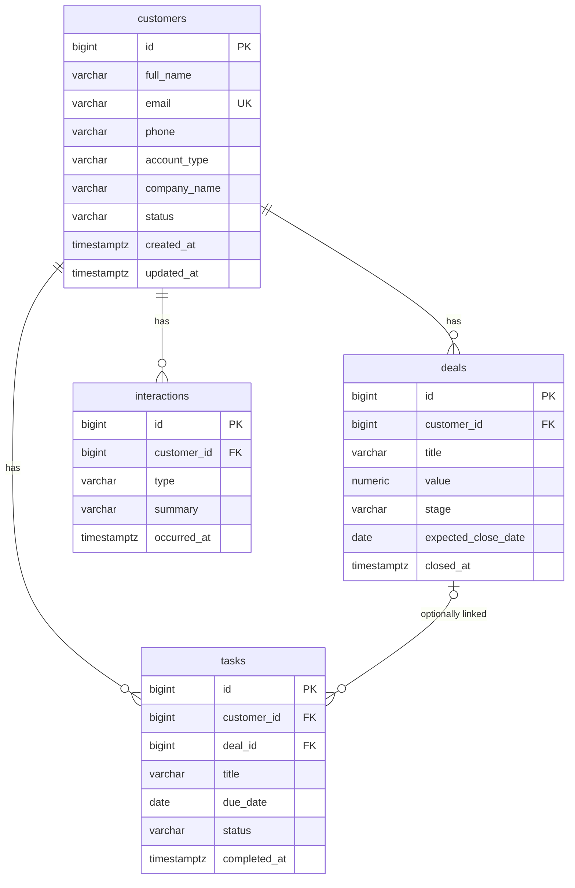

# SeeRM – Low-Level Design (CRUD)

## 1. Scope

The frontend (`frontend/src`) currently has two screens with hard-coded / simulated data:

| Screen | Route | What it needs from the backend |
|---|---|---|
| CRM Dashboard (`features/home/dashboard.jsx`) | `/` | Customer directory (name, company, status, deal value, last contact) with search by name/company; KPI cards: Total Customers, Active Leads, Pipeline Revenue, Tasks Completed |
| New Customer Registration (`features/customer-entry/customer-entry-form.jsx`) | `/customer-entry` | Create customer: full name, email, phone, account type, company |

This document defines the data model, REST API, and validation rules needed to replace the mock data with real CRUD backed by PostgreSQL (`k8s/postgres`) and the .NET API (`backend/seerm-dotnet`).

## 2. Architecture

```
React (frontend)  ──HTTP/JSON──▶  ASP.NET Core API (seerm-dotnet)  ──EF Core/Npgsql──▶  PostgreSQL 17
  dashboard.jsx                     Controllers → Services → SeeRmDbContext                customers, deals,
  customer-entry-form.jsx           DTOs + validation                                      tasks, interactions
```

- **Controller** (`Controllers/`): HTTP routing, model binding, status codes, Swagger metadata.
- **Service** (`Services/`): business rules written as EF Core LINQ (default status, duplicate email check, `closedAt`/`completedAt` handling, KPI aggregation).
- **SeeRmDbContext** (`Data/`): EF Core mapping onto the existing schema (database-first, no migrations). The `DbContext` acts as the repository, so there's no separate repository layer.
- **Errors** (`Infrastructure/`): service exceptions and Postgres constraint errors become `ProblemDetails` (400/404/409).

## 3. Data Model

### 3.1 ER diagram



All tables also have `created_at` and `updated_at` (`updated_at` is maintained by a trigger).

### 3.2 Tables

**customers**: one row per registered customer (the form).

| Column | Type | Rules |
|---|---|---|
| id | BIGINT identity | PK |
| full_name | VARCHAR(150) | required, ≥ 2 chars after trimming |
| email | VARCHAR(254) | required, email format, **unique (case-insensitive)** |
| phone | VARCHAR(15) | required, `^[0-9+\-\s()]{7,15}$` |
| account_type | VARCHAR(20) | `individual` \| `business`, default `individual` |
| company_name | VARCHAR(150) | optional |
| status | VARCHAR(20) | `Lead` \| `Active` \| `Inactive`, default `Lead` |

**deals**: sales opportunities; source of *Deal Value* and *Pipeline Revenue*.

| Column | Type | Rules |
|---|---|---|
| customer_id | BIGINT | FK → customers, cascade delete |
| title | VARCHAR(200) | required |
| value | NUMERIC(12,2) | ≥ 0 |
| stage | VARCHAR(20) | `prospecting` \| `qualification` \| `proposal` \| `negotiation` \| `won` \| `lost` |
| expected_close_date | DATE | optional |
| closed_at | TIMESTAMPTZ | set **iff** stage is `won`/`lost` (CHECK constraint) |

**tasks**: follow-ups; source of *Tasks Completed* and *follow-ups due*.

| Column | Type | Rules |
|---|---|---|
| customer_id | BIGINT | FK → customers, cascade delete |
| deal_id | BIGINT | optional FK → deals, set null on delete |
| title | VARCHAR(200) | required |
| due_date | DATE | optional |
| status | VARCHAR(20) | `open` \| `completed` |
| completed_at | TIMESTAMPTZ | set **iff** status is `completed` (CHECK constraint) |

**interactions**: calls, emails, meetings, notes; source of *Last Contact*.

| Column | Type | Rules |
|---|---|---|
| customer_id | BIGINT | FK → customers, cascade delete |
| type | VARCHAR(20) | `call` \| `email` \| `meeting` \| `note` |
| summary | VARCHAR(500) | required |
| occurred_at | TIMESTAMPTZ | default now() |

### 3.3 Derived values (how the UI fields are computed)

| UI field | Definition |
|---|---|
| Customer directory → Deal Value | `SUM(deals.value)` where stage ≠ `lost` (open + won) |
| Customer directory → Last Contact | `MAX(interactions.occurred_at)`; UI renders it relative ("2 hours ago") |
| KPI → Total Customers | `COUNT(customers)` |
| KPI → Active Leads | `COUNT(customers WHERE status = 'Lead')` |
| KPI → Pipeline Revenue | `SUM(deals.value)` where stage not in (`won`, `lost`) |
| KPI → Tasks Completed | `COUNT(completed tasks) / COUNT(tasks)` |
| KPI → follow-ups due | open tasks with `due_date <= today + 7` |

The view `v_customer_directory` returns one row per customer with `deal_value`, `pipeline_value`, and `last_contact_at` already computed.

### 3.4 Indexes

- `ux_customers_email_lower` (unique, `lower(email)`): duplicate-email check.
- `lower(full_name)`, `lower(company_name)`: dashboard search.
- `customers(status)`, `deals(stage)`, `tasks(status, due_date)`: KPI queries.
- FK indexes on every `customer_id` / `deal_id`; `interactions(customer_id, occurred_at DESC)` for last contact.

## 4. REST API

Base path: `/api`. JSON uses camelCase. Errors use RFC 7807 `ProblemDetails`.

### 4.1 Customers

| Method | Path | Purpose | Success |
|---|---|---|---|
| GET | `/customers?search=&status=&page=1&pageSize=20` | Directory list (from `v_customer_directory`); `search` matches name or company, case-insensitive | 200 |
| GET | `/customers/{id}` | Customer detail | 200 / 404 |
| POST | `/customers` | Create (New Customer form) | 201 + `Location` |
| PUT | `/customers/{id}` | Full update (incl. `status`) | 200 / 404 |
| DELETE | `/customers/{id}` | Delete customer and its deals, tasks, interactions | 204 / 404 |

**Create request** (matches the form's field names):

```json
{
  "fullName": "Sarah Jenkins",
  "email": "sarah.jenkins@apexlogistics.example",
  "phone": "555-201-1001",
  "accountType": "business",
  "company": "Apex Logistics"
}
```

`status` is not on the form, so new customers default to `Lead`. `company` maps to `company_name`; send an empty string or omit it to store `NULL`.

**Directory item response** (matches the dashboard table):

```json
{
  "id": 1,
  "name": "Sarah Jenkins",
  "company": "Apex Logistics",
  "status": "Active",
  "dealValue": 14500.00,
  "lastContactAt": "2026-11-21T18:00:00Z"
}
```

The API returns `dealValue` as a number and `lastContactAt` as ISO-8601. The UI formats them (`$14,500`, "2 hours ago").

**List response envelope**: `{ "items": [...], "page": 1, "pageSize": 20, "totalCount": 20 }`

### 4.2 Deals

| Method | Path | Purpose |
|---|---|---|
| GET | `/customers/{customerId}/deals` | Deals for a customer |
| GET | `/deals/{id}` | Deal detail |
| POST | `/customers/{customerId}/deals` | Create deal |
| PUT | `/deals/{id}` | Update (stage change to `won`/`lost` sets `closed_at = now()`; reopening clears it) |
| DELETE | `/deals/{id}` | Delete (linked tasks keep existing with `deal_id = NULL`) |

### 4.3 Tasks

| Method | Path | Purpose |
|---|---|---|
| GET | `/tasks?customerId=&status=&dueBefore=` | Filtered task list |
| GET | `/tasks/{id}` | Task detail |
| POST | `/customers/{customerId}/tasks` | Create task (optional `dealId` must belong to the same customer) |
| PUT | `/tasks/{id}` | Update (status → `completed` sets `completed_at = now()`; → `open` clears it) |
| DELETE | `/tasks/{id}` | Delete |

### 4.4 Interactions

| Method | Path | Purpose |
|---|---|---|
| GET | `/customers/{customerId}/interactions` | History, newest first |
| POST | `/customers/{customerId}/interactions` | Log a call / email / meeting / note |
| PUT | `/interactions/{id}` | Edit |
| DELETE | `/interactions/{id}` | Delete |

### 4.5 Dashboard

`GET /dashboard/summary`

```json
{
  "totalCustomers": 20,
  "activeLeads": 7,
  "pipelineRevenue": 146850.00,
  "tasksCompleted": 18,
  "tasksTotal": 22,
  "followUpsDue": 3
}
```

The UI's trend lines ("+12% this month", "+8.4% vs last quarter") are hard-coded for now. They can be computed later from `customers.created_at` and `deals.created_at`/`closed_at`.

## 5. Validation & Business Rules

Server-side validation mirrors the form so the API can't be bypassed. The database enforces the same rules again as CHECK constraints.

| Field | Rule | Error message (same as UI) |
|---|---|---|
| fullName | required, ≥ 2 chars | "Full name is required" / "Name must be at least 2 characters" |
| email | required, `^[^\s@]+@[^\s@]+\.[^\s@]+$` | "Email is required" / "Please enter a valid email address" |
| phone | required, `^[0-9-+\s()]{7,15}$` | "Phone number is required" / "Please enter a valid phone number" |
| accountType | `individual` \| `business` | — |

Further rules:
1. **Duplicate email** → `409 Conflict` (checked in the service; the unique index catches race conditions, so map Postgres error `23505` to 409 too).
2. **Unknown enum values** (status, stage, type) → `400`.
3. **Child resource on a missing customer** → `404`.
4. **Trim** string inputs; store empty `company` as `NULL`.
5. **Deletes are hard deletes** with cascade. To retire a customer without losing history, set `status = 'Inactive'` instead.

## 6. Key SQL

```sql
-- Directory with search + paging
SELECT * FROM v_customer_directory
WHERE (@search IS NULL OR lower(full_name) LIKE '%' || lower(@search) || '%'
                       OR lower(company_name) LIKE '%' || lower(@search) || '%')
  AND (@status IS NULL OR status = @status)
ORDER BY last_contact_at DESC NULLS LAST
LIMIT @pageSize OFFSET (@page - 1) * @pageSize;

-- Create customer
INSERT INTO customers (full_name, email, phone, account_type, company_name)
VALUES (@fullName, @email, @phone, @accountType, NULLIF(btrim(@company), ''))
RETURNING *;

-- Dashboard summary
SELECT
  (SELECT count(*) FROM customers)                                         AS total_customers,
  (SELECT count(*) FROM customers WHERE status = 'Lead')                   AS active_leads,
  (SELECT COALESCE(sum(value), 0) FROM deals WHERE stage NOT IN ('won','lost')) AS pipeline_revenue,
  (SELECT count(*) FROM tasks WHERE status = 'completed')                  AS tasks_completed,
  (SELECT count(*) FROM tasks)                                             AS tasks_total,
  (SELECT count(*) FROM tasks WHERE status = 'open' AND due_date <= current_date + 7) AS follow_ups_due;
```

## 7. Database Scripts

Located in `sqlscripts/`, run in order:

| Script | Purpose |
|---|---|
| `001_create_tables.sql` | Drops and recreates tables, indexes, triggers, and `v_customer_directory`. **Destructive: dev only.** |
| `002_insert_mock_data.sql` | Truncates and seeds 20 customers, 30 deals, 22 tasks, 27 interactions. Timestamps are relative to `now()`. The first four customers match the dashboard's hard-coded rows. |

Run against the local Kubernetes Postgres (from the repo root, Git Bash):

```bash
for f in sqlscripts/001_create_tables.sql sqlscripts/002_insert_mock_data.sql; do
  kubectl exec -i postgres-0 -- sh -c 'psql -v ON_ERROR_STOP=1 -U "$POSTGRES_USER" -d "$POSTGRES_DB"' < "$f"
done
```
